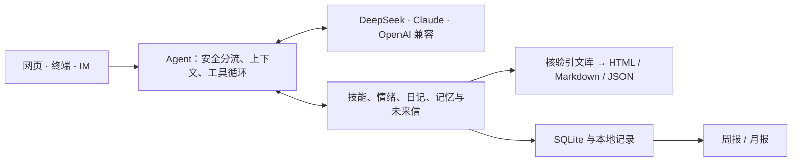

# 我的答案之书 · Answer Life

> 「我投了十二份简历，几乎没回音。现在有点不知道从哪改起。」

一个陪你把问题想具体的本地 Agent。你可以只聊几句，也可以翻出一页书，带走一件这周能试的小事。

[快速开始](#快速开始) · [能做什么](#能做什么) · [架构](#架构) · [使用说明](agent/README.md) · [独立 Skill](answer-book/)


## 能做什么

| 入口 | 可以怎么用 |
| --- | --- |
| 首页 | 点一只情绪鸟记下此刻，或写一句今天放不下的话。 |
| 对话 | 让小鸟接住你说的事。想借书想一想时，点「翻一页书」。 |
| 答案页 | 读一句有出处的原文、一种不同的看法，以及一个七天内能试的小动作。支持复制、下载文字和打印。 |
| 记录 | 看日记、心情日历、答案页和未来信。周报、月报先选书摘，再把实际记录写成短札。 |
| 我的 | 修改资料和头像，查看「我对你的了解」，管理技能、记忆和通知。 |

## 快速开始

需要 [uv](https://docs.astral.sh/uv/) 和 Python 3.11 或以上。

```bash
git clone https://github.com/wangluting0126-hue/Answer-life.git
cd Answer-life/agent
uv sync --locked
ANSWERLIFE_HOME="$(mktemp -d)" AI_PROVIDER=mock AI_FALLBACK= uv run --locked answerlife serve
```

打开 <http://127.0.0.1:8020>。在网页里点「翻一页书」，发送「测试出页」，就能看到一张完整示范页。模拟模式使用虚构样例。

要用 DeepSeek，回到 `agent/` 运行 `uv run --locked answerlife setup`，选 `deepseek` 并在终端提示里填入自己的 Key。启动、渠道配对和验收命令见 [Agent 使用说明](agent/README.md)。

## 架构



模型决定何时追问、读技能或调工具。原文由核验过的引文 ID 注入，报告时间范围由程序计算。回看的书卡和本地短札不需要模型；点击「请模型再写一版」后，才会将当期少量记录发给已配置的提供商。

### 目录

| 路径 | 用途 |
| --- | --- |
| [agent/](agent/) | 可运行的网页、终端和 IM Agent |
| [agent/src/answerlife/skills/](agent/src/answerlife/skills/) | 应用内置技能与引文库 |
| [agent/tests/](agent/tests/) | Agent、回看、持久化和安全边界的测试 |
| [answer-book/](answer-book/) | 可以单独安装到 AI 客户端的原始 Skill |
| [开始阅读.html](开始阅读.html) | 可直接用浏览器打开的五组虚构示例 |
| [设计与验收/](设计与验收/) | 原始 Skill 的设计与验收材料 |

使用说明的组织参考 [WealthPilot](https://github.com/Jackychen-12/wealthpilot)，阅读体验参考 [Life Designer](https://github.com/Jackychen-12/life-designer)。
