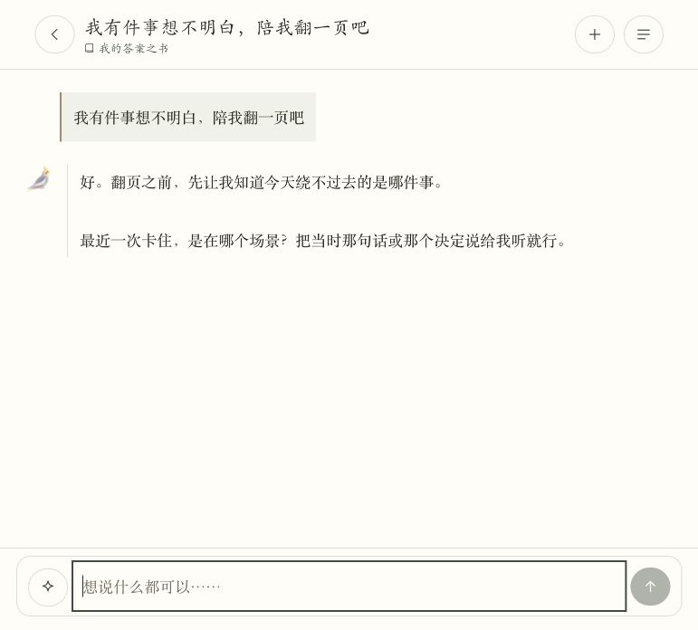
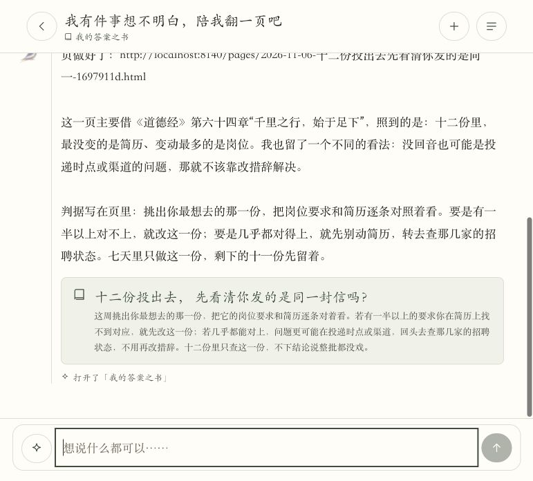
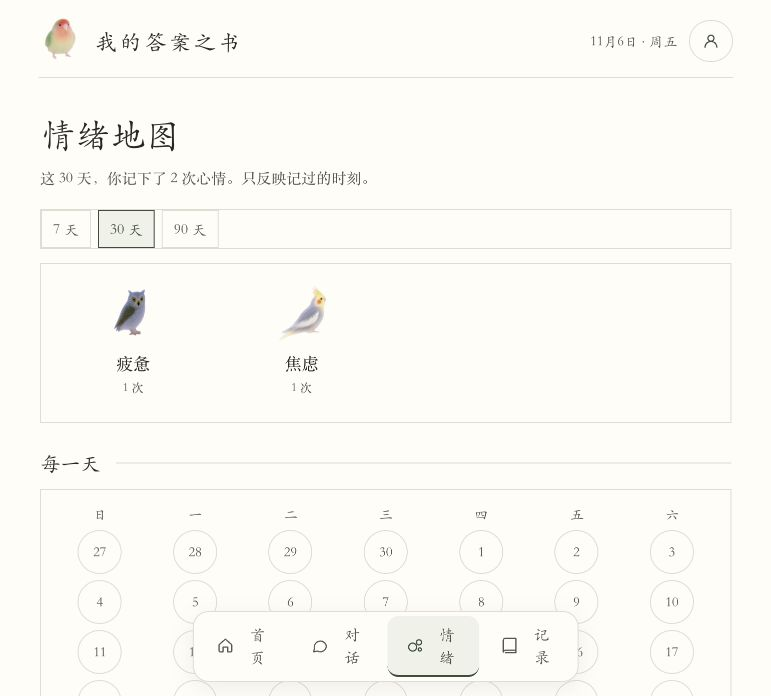
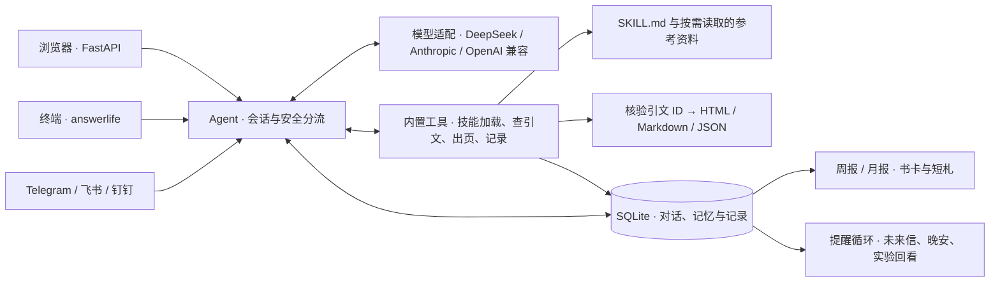

# 我的答案之书 · Answer Life

**一个本地运行的个人陪伴 Agent。把说不清的事聊具体，借一段有出处的书摘换个角度，再带走一件这周能试的小事。**

[实测演示](#实测演示) · [安装和启动](#安装和启动) · [文档导航](docs/) · [HTTP API](docs/api.md) · [技术架构](#技术架构) · [验收与下一步](#验收与下一步)


## 为什么做

投了十几份简历，只有一封自动确认，原本只是一次求职反馈，聊着聊着很容易变成「是不是我不适合这个行业」。这时候，一个更有用的对话要能把事实、猜测和还缺的信息分开。等用户想行动时，再一起选一个足够小的动作。

答案之书把这个过程做成一条可以回看的路径。用户可以只聊、做一次呼吸或记下心情。主动翻书时，Agent 会先理解具体处境，给出一段可核对的原文和一种不同解释，最后把下一步写进答案页。隔一阵再回来，能接着看尝试过什么、有哪些新记录。

| 用户卡在哪里 | 产品怎么帮 |
| --- | --- |
| 只知道不舒服，说不清哪件事 | 选情绪鸟、做呼吸，或从一个具体场景开始聊 |
| 聊完得到一堆通用建议，很难动手 | 把用户的原话、引文、另一种解释和七天尝试放在同一页 |
| 当时想明白了，过几天又忘了 | 答案页、日记、心情和未来信进入记录，可按周和月回看 |
| 担心 AI 乱记或乱引 | 展示引文出处和依据，允许查看、删除记忆，长期记忆由用户授权 |

## 实测演示

这一轮用虚构的求职资料，在本地网页里调用 DeepSeek。先让 Agent 追问卡住的场景，再补充「两周投了十二份、覆盖三个方向、只用一版简历、仅有一次自动确认」。成品把问题收敛成一个七天尝试：挑一份目标岗位，把要求和自己做过的事逐条对照。

| 第一步 · 说清楚一件事 | 第二步 · 翻出一页可回看的答案 |
| --- | --- |
|  | [](agent/docs/demo/answer-page.jpg) |

| 情绪回看 · 圆形日历与小鸟 | 月报 · 书摘开头，再写短札 |
| --- | --- |
|  |  |

[月报页尾实拍](agent/docs/demo/monthly-footer.jpg) · [五组可离线阅读的独立 Skill 示例](开始阅读.html)

## 安装和启动

需要 Git、Python 3.11+ 和 [uv](https://docs.astral.sh/uv/)。以下命令在 macOS 或 Linux 的终端运行。

### 装成可直接调用的命令

```bash
git clone https://github.com/wangluting0126-hue/Answer-life.git
cd Answer-life
uv tool install ./agent
uv tool update-shell
```

重新打开终端，运行 `answerlife --help` 确认可用。安装后可在任意目录运行 `answerlife`。

```bash
answerlife setup
answerlife doctor
answerlife serve
```

在 `setup` 里选 `deepseek`，输入你自己的 Key，手机渠道先选 N。打开 <http://127.0.0.1:8020>，填写资料或跳过，点一只鸟，点击「翻一页书」，再说一件最近反复在想的事。

### 没有模型 Key，先体验

```bash
ANSWERLIFE_HOME="$(mktemp -d)" AI_PROVIDER=mock AI_FALLBACK= answerlife serve
```

点「翻一页书」后发送「测试出页」，即可打开内置示范页。这次演示使用临时数据目录。开发者可以在 `agent/` 运行 `uv sync --locked`，再用 `uv run --locked answerlife ...` 执行同样的子命令。

### 像使用 OpenClaw 一样，从命令进入

| 命令 | 用途 |
| --- | --- |
| `answerlife setup` | 配置模型和可选的手机渠道 |
| `answerlife doctor` | 检查本地数据库、引文库并请求模型验证连通性 |
| `answerlife` | 开启终端对话，端口空闲时同时启动网页与已配置的 IM |
| `answerlife chat` | 只开启终端对话 |
| `answerlife serve` | 运行网页、API、IM 和提醒循环 |
| `answerlife skills list` | 查看内置与已安装技能 |
| `answerlife skills install ./my-skill` | 安装一个含 `SKILL.md` 的目录 |
| `answerlife pair telegram` | 生成 Telegram 机器人配对码 |

网页已由 `answerlife serve` 启动时，另开终端运行 `answerlife chat` 即可。如果 `8020` 显示「已被占用」，用 `lsof -nP -iTCP:8020 -sTCP:LISTEN` 查看监听进程。也可以运行 `PORT=8021 answerlife serve`，再打开 <http://127.0.0.1:8021>。

进入终端或已配对的机器人后，输入 `/skills` 查看技能，`/skill answer-book` 开始翻书，`/mood 7 有点累` 打卡，`/pages` 找最近的答案页。模型配置、飞书／钉钉、完整命令和自定义技能示例见 [命令手册](docs/cli.md)。

## 选择接入方式

| 如果你想 | 从这里开始 |
| --- | --- |
| 在电脑上体验，或接入自己的聊天机器人 | [命令与配置](docs/cli.md) |
| 在自己的程序里复用对话、技能和答案页 | [HTTP API](docs/api.md) · [Python 示例](examples/chat.py) |
| 在支持 Agent Skills 的客户端中使用翻书能力 | [独立 Skill 与应用内技能](docs/skills.md) |
| 修改代码、验证功能或提交贡献 | [架构](docs/architecture.md) · [贡献指南](CONTRIBUTING.md) |

## 技术架构

网页和 IM 由同一个 FastAPI 进程接收。终端可直接运行 Agent，也可用默认命令和网页共用一个进程。每个入口可以有自己的会话，共用本地记录和技能。



Agent 读取当前会话和技能索引，按需激活 `SKILL.md`。模型负责追问、选择工具和组织回复，程序负责核验引文、生成文件、授权检查和保存。技术选型、模块位置和调用路径见 [技术架构详解](docs/architecture.md)。

应用默认绑定本机地址，配置和记录位于 `~/.answerlife`，个人资料和头像在浏览器本地保存。启用在线模型后，当前任务需要的对话及上下文会发给所选的提供商。

## 验收与下一步

已完成的本地浏览器验收覆盖资料、头像、情绪、真实模型出页、历史恢复、记录和周月报等 27 项。20 项通过、5 项未通过、1 项部分确认、1 项未执行，共记录 13 次成功的 DeepSeek 请求。

优先处理周报和月报重写后刷新丢失，让用户能找回已生成的内容。其次是约束模型引用时间和写入记忆时保留原话，并让报告始终用答案之书的视角对用户说话。回归时用同日跨会话、明日计划和页面刷新三个场景对照复测。

本地测试命令、可选渠道与日常运行说明见 [命令手册](docs/cli.md)。写法与体验参考 [WealthPilot](https://github.com/Jackychen-12/wealthpilot) 和 [Life Designer](https://github.com/Jackychen-12/life-designer)。
