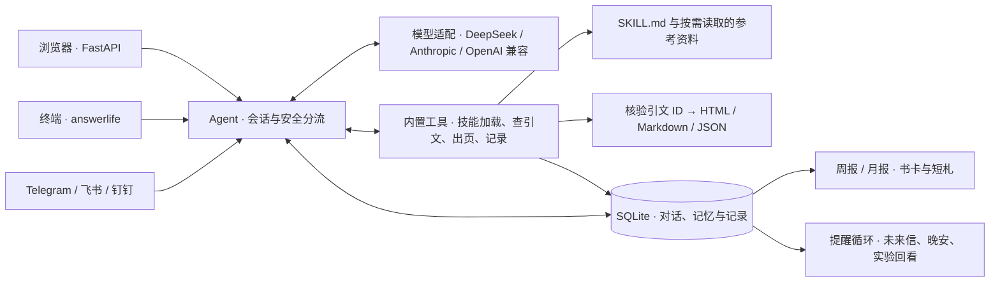

# 技术架构

网页和 IM 由同一个 FastAPI 进程接收。终端可直接运行 Agent，也可用默认命令和网页共用一个进程。每个入口可以有自己的会话，共用本地记录和技能。

一次翻页会经过四步。

1. **整理上下文。** 对话入口提交用户原话和会话 ID。Agent 读取近期消息、当前日期和技能索引，并根据安全检查调整可用工具。终端和 IM 的打卡、查记忆等命令有直接处理路径。
2. **按需激活技能。** 模型根据任务决定追问或调用 `use_skill`，需要时再读取参考文件。已激活的技能和会话关联，自定义技能的内容通过说明文件交给模型。
3. **把生成和核验分开。** 模型负责选择候选引文、解释与行动建议。程序验证引文 ID、出处和页面字段，再输出 HTML、Markdown、JSON。网页收到结构化结果后展示答案卡，用户可直接打开。
4. **写入记录并回看。** SQLite 保存会话及记录索引，成品落到本地文件。回看按实际日期范围选记录和书卡，默认由程序生成短札。点「请模型再写一版」才发起该次模型请求。

| 从哪读代码 | 负责什么 |
| --- | --- |
| [入口与网关](../agent/src/answerlife/server.py) · [CLI](../agent/src/answerlife/__main__.py) · [渠道](../agent/src/answerlife/channels/) | 接入、命令、API 和渠道配对 |
| [Agent](../agent/src/answerlife/agent.py) · [模型适配](../agent/src/answerlife/llm.py) · [工具](../agent/src/answerlife/tools.py) | 单轮编排、会话锁、模型调用与工具结果 |
| [技能注册](../agent/src/answerlife/skills.py) · [答案页](../agent/src/answerlife/book.py) | 技能发现、按需加载、引文与出页 |
| [本地存储](../agent/src/answerlife/store.py) · [回看](../agent/src/answerlife/reflections.py) · [提醒](../agent/src/answerlife/routines.py) | 数据保存、周期总结与提醒 |
| [网页](../agent/src/answerlife/web/index.html) · [独立 Skill](../answer-book/) | 浏览器体验与可单独使用的技能目录 |

应用默认绑定本机地址，配置和记录位于 `~/.answerlife`，个人资料和头像在浏览器本地保存。启用在线模型后，当前任务需要的对话及上下文会发给所选的提供商。
